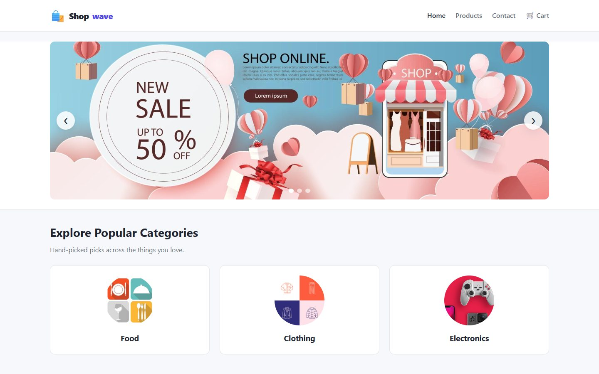
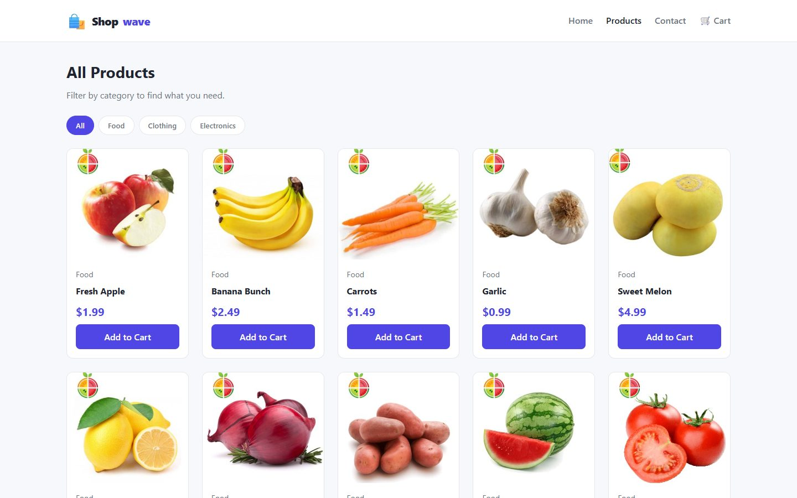
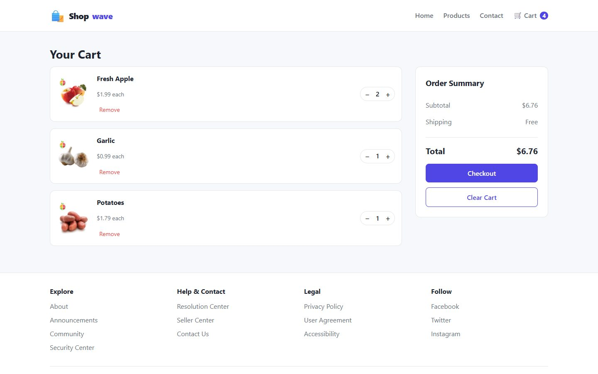

# 🛍️ Shopwave — A Mock E‑Commerce Website

> My very first HTML / CSS / JavaScript project — a 1st‑semester university
> assignment — lovingly preserved *and* given a modern second life.

This repository tells a little story. It holds **two versions** of the same
mock online store:

| Version | Folder | What it is |
| ------- | ------ | ---------- |
| 🕰️ **Legacy** | [`legacy/`](legacy/) | The original, exactly as it was submitted. Untouched, bugs and all — kept for nostalgia. |
| ✨ **Latest** | [`latest/`](latest/) | A modular, modern refactor of the same site. Same idea, grown‑up code. |

There is no framework, no build step, and no dependencies — just plain HTML,
CSS and JavaScript, the way the original was written. Only the *craft* changed.

**▶️ Try it live:** [latest version](https://umair-habibx123.github.io/practice-ecommerce/) ·
[legacy version](https://umair-habibx123.github.io/practice-ecommerce/legacy/home.html)



---

## 📸 What the site does

A small pretend storefront with four pages:

- **Home** — image carousel, category highlights, featured products
- **Products** — full catalogue with category filtering
- **Cart** — add / remove items, quantities, live total, checkout modal
- **Contact** — a validated contact form

Everything is client‑side. The "cart" lives in your browser's `localStorage`,
so there is no server and no real money involved. 🙂

| Products | Cart |
| --- | --- |
|  |  |

---

## 🚀 How to run it

Both versions are static sites. The **legacy** version opens straight from the
file system, but the **latest** version uses JavaScript **ES modules**, which
browsers only load over `http://` (not `file://`). So the latest version needs
a tiny local web server — any one of the options below works.

### ▶️ Run the **Legacy** version (the nostalgic one)

No server required.

1. Open the `legacy/` folder.
2. Double‑click **`home.html`** to open it in your browser.

That's it — it's the project frozen in time.

### ▶️ Run the **Latest** version (the refactor)

Pick whichever you already have installed and run it from the project root:

```bash
# Option A — Python (almost always pre-installed)
cd latest
python -m http.server 8000
# then open http://localhost:8000

# Option B — Node.js
npx serve latest
# then open the URL it prints

# Option C — VS Code
# Install the "Live Server" extension, then right-click
# latest/index.html → "Open with Live Server"
```

Open **`http://localhost:8000`** (or the URL your tool prints) and you'll land
on the home page.

> 💡 **Why the server?** Opening `latest/index.html` directly with `file://`
> will show a blank page and a CORS / module error in the console. That's
> expected — ES modules require `http://`. The legacy version doesn't use
> modules, so it has no such requirement.

---

## 🗂️ Project structure

```
practice-ecommerce/
├── README.md            ← you are here
│
├── legacy/              ← the original 1st-semester project (unchanged)
│   ├── home.html
│   ├── products.html
│   ├── cart.html
│   ├── contact.html
│   ├── *.css  *.js
│   └── *.jpg / *.png / *.webp   (all assets)
│
└── latest/             ← the modern, modular refactor
    ├── index.html
    ├── products.html
    ├── cart.html
    ├── contact.html
    ├── css/
    │   └── styles.css           ← one design system (CSS custom properties)
    ├── js/
    │   ├── data/products.js     ← single catalogue (source of truth)
    │   ├── store/cart.js        ← reactive localStorage cart store
    │   ├── components/          ← reusable UI (header/footer, cards, carousel, toast)
    │   └── pages/               ← one entry module per page
    └── assets/
        └── img/                 ← all images
```

---

## 🔧 What changed in the refactor (and why)

The legacy code worked — it earned its grade! — but it carried the usual
first‑project rough edges. Here's the honest before/after:

| Area | 🕰️ Legacy | ✨ Latest |
| ---- | --------- | --------- |
| **Header & footer** | Copy‑pasted into all 4 HTML files | Rendered once from a single `layout.js` component |
| **Styling** | Same CSS rules duplicated across 4 stylesheets | One `styles.css` with design tokens (CSS variables) |
| **Product data** | Hard‑coded twice; names collided (three "Product 7"s) | One `products.js` catalogue, every item a stable `id` |
| **The cart** | **Two** competing carts (`cart` *and* `productsInCart`) that disagreed | One store with `{ id, qty }`, prices looked up live |
| **Prices in cart** | Stored as display strings, re‑parsed from the DOM | Real numbers, totals computed from the catalogue |
| **Quantities** | None — duplicates piled up as separate rows | Proper +/− quantity controls |
| **"Added to cart"** | Full‑screen modal you had to dismiss | Auto‑dismissing toast |
| **JavaScript** | Global functions, duplicate definitions, inline `onclick` | ES modules, event listeners, single responsibility |
| **Checkout button** | Bound to an element id that didn't exist (`checkout`) | Working modal with form validation |
| **Layout** | Fixed widths, horizontal scrollbars | Responsive CSS grid, mobile nav |
| **Accessibility** | Minimal | Landmarks, `aria-*`, labels, keyboard‑friendly |

Same project, same spirit — just refactored the way I'd write it today.

---

## 🎓 A note to my first‑semester self

Thanks for the messy, enthusiastic code. Every duplicated stylesheet and
every global function was a lesson. This refactor isn't about deleting that —
the original is right there in [`legacy/`](legacy/), preserved on purpose. It's
about showing how far a little practice goes. 💙

---

## 📄 License

The code is [MIT](LICENSE) © 2023 [Umair Habib](https://github.com/Umair-Habibx123).
The product and banner images are stock or web images used for learning, and
aren't covered by the license.

---

*This is a learning project. It is not a real store and processes no real
payments.*
